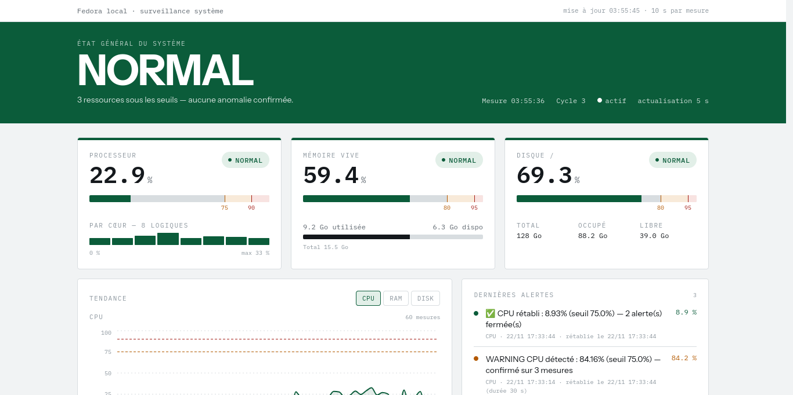
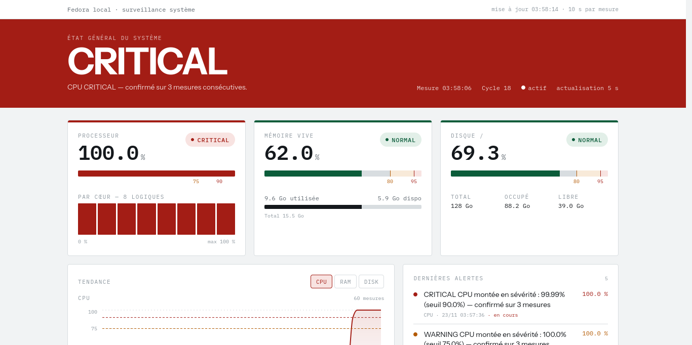
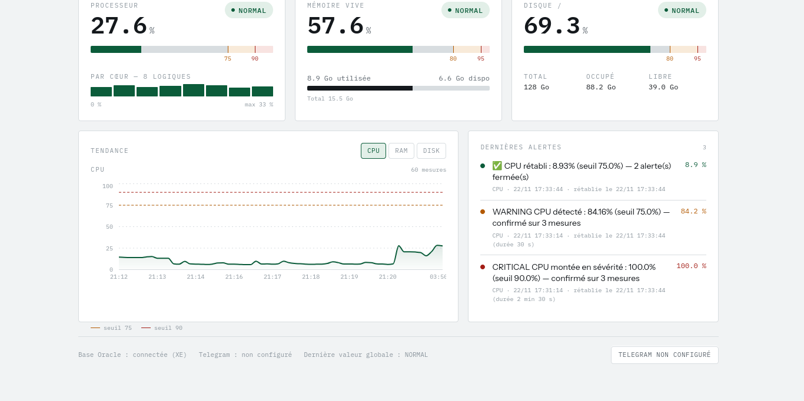
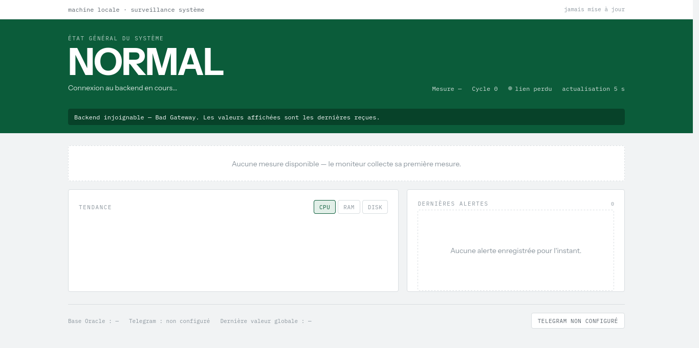

# Résultats — Étape 6 : Dashboard React

Date : 23/11/2026 — Phase 1.

## Réalisé

| Composant | Fichier | Rôle |
|---|---|---|
| Socle | `package.json`, `vite.config.ts`, `tsconfig.json` | Vite 8 + React 19 + TS 5.9 + Tailwind 4 + proxy `/api` → `127.0.0.1:5000` |
| Types | `src/types.ts` | typage strict des 6 réponses de l'API (étape 5) |
| Client API | `src/api/client.ts` | `fetch` avec délai de 8 s, `ApiError`, aucun secret |
| Horodatages | `src/api/dates.ts` | normalisation des **2 conventions** de l'API (voir « Découverte ») |
| Rafraîchissement | `src/hooks/useDashboard.ts` | polling 5 s, 3 endpoints en parallèle, conservation du dernier état connu |
| Design system | `src/index.css`, `src/state.ts` | tokens papier/encre/états, polices embarquées (npm, pas de CDN) |
| Composants | `src/components/*.tsx` | `StateBand`, `MetricCard`, `ThresholdGauge`, `StatusBadge`, `MetricDetails`, `HistoryChart`, `AlertsList` |
| Page | `src/App.tsx` | mise en page, onglets de ressource, état des services, bouton test Telegram |

Dépendances (pinnées) : `react` 19.3.1, `recharts` 3.11.0, `tailwindcss` +
`@tailwindcss/vite` 4.3.5, `vite` 8.3.8, `typescript` 5.9.3,
`@fontsource/instrument-sans` + `@fontsource/ibm-plex-mono` 5.3.0.
Aucun gestionnaire d'état externe, aucun CSS framework supplémentaire.

## Direction visuelle

Pas de dashboard SaaS générique : **panneau d'instrument de mesure**.

- **La couleur n'exprime que l'état** (NORMAL `#0B5C3A`, WARNING
  `#B35900`, CRITICAL `#A31D15`) — aucun bleu de lien ni accent
  décoratif.
- **Signature : la jauge à seuils zonés** — chaque carte imprime les
  zones WARNING/CRITICAL sur la piste avec les seuils annotés en
  mono : on voit la place restante avant la falaise, pas seulement la
  valeur.
- **Moment fort : la bande d'état pleine largeur** dont le fond prend
  la couleur de l'état général — impossible de manquer un CRITICAL en
  ouvrant l'onglet.
- Typo : `Instrument Sans` (titrage) + `IBM Plex Mono` (tous les
  chiffres, tabulaires — les valeurs ne dansent pas entre deux
  actualisations). Polices embarquées via npm : le dashboard marche
  hors-ligne.

## Données réelles uniquement

- Toutes les valeurs viennent de l'API Flask (`/api/status`,
  `/api/metrics/history`, `/api/alerts`) → donc de psutil et d'Oracle.
  **Aucun mock, aucune valeur codée en dur.**
- Auto-refresh toutes les 5 s ; en cas de coupure du backend, les
  dernières valeurs restent affichées avec une bannière explicite
  (jamais d'écran vide ni de blanc).
- **Aucun secret dans le frontend** : chemins relatifs `/api` uniquement,
  ni `import.meta.env`, ni token Telegram — il reste dans `.env` côté
  Flask.

## Captures (Firefox headless, données réelles)

| État | Capture |
|---|---|
| NORMAL |  |
| CRITICAL (charge réelle déclenchée) |  |
| Alertes réelles + rétablissement |  |
| Backend coupé |  |

## Découverte : deux conventions d'horodatage dans l'API

Constaté à l'étape 6 en comparant les heures affichées :

| Source | Format | Fuseau |
|---|---|---|
| `metrics[].collected_at` (historique) | naïf « `2026-11-22 14:42:04` » | **UTC** (Python `now(utc)` tronqué avant insertion Oracle) |
| `alerts[].started_at/resolved_at` | naïf « `2026-11-22 17:31:14.700216` » | **heure locale** (`CURRENT_TIMESTAMP` d'Oracle, fuseau de session) |
| `monitor.last_collect` | ISO explicite « `…+00:00` » | UTC |

`new Date()` interprète les valeurs naïfs de façon variable selon le
moteur : l'axe des temps du graphe affichait l'heure UTC. Corrigé dans
`src/api/dates.ts` avec des helpers explicites (`parseUtc`,
`parseLocal`, `localHm(s)`, `localDm`, `localSpanSeconds`), utilisés
par `HistoryChart`, `AlertsList` et `StateBand`. **Backend inchangé**
(le contrat de l'étape 5 reste valide).

## Anomalies corrigées pendant l'étape

1. Import `../types` depuis `src/state.ts` → `./types` (compilation).
2. Axe Y rogné (« 100 » affiché « .00 ») : marge du graphe corrigée.
3. Heures UTC affichées partout → helpers d'horodatage (ci-dessus).
4. Libellé « TENDANCE » dupliqué (en-tête + titre interne).
5. Alertes de rétablissement : `resolved_at` est `null` (leur
   horodatage est `started_at`) → repli explicite + durée correcte
   (« rétablie le 22/11 17:33:44 (durée 30 s) »).
6. Code mort supprimé (`statePhrase`, `SEVERITY`, champ `label`).
7. Panneau Tendance vide quand le backend ne répond pas → état vide
   explicite.

## Tests — tout passe

| Test | Résultat |
|---|---|
| `tsc --noEmit` | OK (strict, `noUnusedLocals`) |
| `npm run build` (prod) | OK — avertissement chunk > 500 kB dû à Recharts, non bloquant |
| 5 suites backend (`collector`, `detector`, `monitor`, `telegram`, `api`) | 5/5 OK |
| Validation visuelle NORMAL | OK — 3 cartes, jauges, tendance, alertes, pied de page |
| Validation visuelle CRITICAL | OK — charge réelle 8 cœurs × 130 s → bande rouge, badge, jauges pleines, alerte listée |
| Rétablissement | OK — retour à NORMAL automatique + alertes 85 (CRITICAL, fermée) et 86 (rétablissement) en base |
| Backend coupé | OK — bannière « Backend injoignable », « lien perdu », dernières valeurs conservées |
| `POST /api/alerts/test` sans config | OK — réponse JSON propre affichée par le bouton |

## Lancement

```bash
# Terminal 1 — backend (Oracle doit être démarré : docker start oracle-pfe)
cd backend && ./venv/bin/python run.py

# Terminal 2 — frontend
cd frontend && npm run dev
# → http://localhost:5173  (Vite proxye /api vers 127.0.0.1:5000)
```

## Limites connues / suite

- `frontend/dist/` n'est pas encore servi : seule la **dev proxy**
  est en place. Le mode de production (servir `dist/` par Flask ou
  nginx) reste à définir — candidat pour la recette (étape 7).
- Vite écoute sur `localhost` (IPv6 `::1`) : ouvrir
  `http://localhost:5173`, pas `127.0.0.1:5173`.
- Telegram reste non configuré (`.env` vide) : le bouton de test
  renvoie « TELEGRAM_BOT_TOKEN absent de .env » tant que le token
  n'est pas fourni.

## Validation

Étape 6 à valider par l'utilisateur avant de démarrer l'étape 7
(recette Phase 1).
